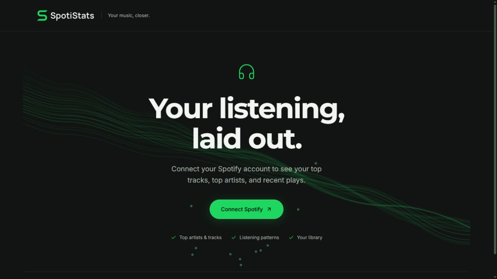

<p align="center">
  
</p>

<p align="center">
  <strong>Your listening, in focus.</strong><br />
  A personal Spotify dashboard for the songs, artists, and habits that make your sound.
</p>

<p align="center">
  <a href="#features">Features</a> ·
  <a href="#getting-started">Getting started</a> ·
  <a href="#configuration">Configuration</a> ·
  <a href="#deployment">Deployment</a>
</p>

SpotiStats brings your listening data into a responsive interface built with React, TypeScript, and Kokonut UI. Explore your favorites over time, discover patterns in recent plays, and optionally use AI to reflect on your music taste.

## Preview



*The sign-in screen. Dashboard content is loaded from your connected Spotify account.*

## Features

| Area | What you can explore |
| --- | --- |
| **Favorites** | Top artists and tracks across Spotify's short-term, medium-term, and long-term ranges. |
| **Listening patterns** | A weekly heatmap, daily favorites, and playlist activity based on your latest 50 plays. |
| **Your sound** | Genre distribution and an obscurity score derived from available Spotify popularity data. |
| **Current playback** | Album artwork, track details, playback progress, and device name, refreshed every 15 seconds. |
| **Library** | Counts of followed artists, liked songs, saved albums, and playlists, plus a playlist carousel. |
| **Optional AI insights** | A taste profile, recent-listening recap, and chat about your stats, powered by Groq. |
| **Interface** | Responsive layouts, keyboard controls, reduced-motion support, spotlight cards, animated beams, and an interactive dot background. |

## Technology

| Layer | Stack |
| --- | --- |
| Frontend | React, TypeScript, Vite, Tailwind CSS, Kokonut UI, Motion, Recharts |
| Backend | Node.js, Express, Axios |
| Integrations | Spotify Web API; optional Groq API |
| Sessions | In-memory storage locally; optional PostgreSQL persistence |

## Getting started

### Prerequisites

- [Node.js](https://nodejs.org/) **22.12 or newer** and npm.
- A Spotify developer app with its Client ID and Client Secret.
- Optional: a Groq API key for AI features and PostgreSQL for persistent sessions.

> [!IMPORTANT]
> Spotify requires the **owner of a Development Mode app to have an active Premium subscription**. Additional users must be added to the app's allowlist. Successful sign-in alone does not guarantee access to listening data. See [Spotify's quota modes](https://developer.spotify.com/documentation/web-api/concepts/quota-modes) for current requirements.

### 1. Clone and install

```bash
git clone https://github.com/eloooong/spoti.git
cd spoti
npm ci --prefix server
npm ci --prefix client
```

### 2. Configure your Spotify app

Open the [Spotify Developer Dashboard](https://developer.spotify.com/dashboard), select your app, and register this redirect URI:

```text
http://127.0.0.1:8888/callback
```

Use the exact same value in your environment file. Spotify accepts HTTP for explicit loopback addresses such as `127.0.0.1`; see the [redirect URI requirements](https://developer.spotify.com/documentation/web-api/concepts/redirect_uri).

### 3. Create the environment file

Copy [`server/.env.example`](server/.env.example) to `server/.env`:

```bash
cp server/.env.example server/.env
```

On PowerShell, use `Copy-Item server/.env.example server/.env` instead. Set your credentials:

```dotenv
SPOTIFY_CLIENT_ID=your_client_id
SPOTIFY_CLIENT_SECRET=your_client_secret
SPOTIFY_REDIRECT_URI=http://127.0.0.1:8888/callback
PORT=8888
```

`server/.env` is excluded from Git. Keep credentials on the server.

### 4. Build and run

```bash
npm run build --prefix client
npm start --prefix server
```

Open [http://127.0.0.1:8888](http://127.0.0.1:8888) and select **Connect Spotify**. Express serves the compiled frontend and handles authentication and API requests.

## Development

Run the backend and Vite in separate terminals, from the repository root:

```bash
# Terminal 1
npm start --prefix server
```

```bash
# Terminal 2
npm run dev --prefix client -- --host 127.0.0.1
```

Use [http://127.0.0.1:5173](http://127.0.0.1:5173) for hot reload. Vite proxies `/api`, `/login`, `/callback`, and `/logout` to the backend. OAuth returns to port `8888`; after signing in, return to port `5173` to continue development. Use `127.0.0.1` consistently so both ports share the session cookie.

```bash
# Type-check and build
npm run build --prefix client

# Lint the frontend
npm run lint --prefix client
```

## Configuration

The server loads `server/.env` when started with the commands above.

| Variable | Required | Purpose |
| --- | --- | --- |
| `SPOTIFY_CLIENT_ID` | Yes | Client ID from your Spotify developer app. |
| `SPOTIFY_CLIENT_SECRET` | Yes | Client Secret used by the server to exchange and refresh tokens. |
| `SPOTIFY_REDIRECT_URI` | Yes | Callback URL; must exactly match a registered redirect URI. |
| `PORT` | No | Backend port. Defaults to `8888`. |
| `GROQ_API_KEY` | No | Enables the AI profile, recap, and chat. Leave blank to keep them hidden. |
| `GROQ_MODEL` | No | Overrides the model used for Groq chat completions. |
| `DATABASE_URL` | No | PostgreSQL connection string for persistent sessions. |
| `ALLOWED_ORIGIN` | No | Allowed browser origin for CORS. Set this to your deployed site's origin. |

### Sessions and AI

Each visitor receives a separate session cookie. Spotify access and refresh tokens remain on the backend. In-memory sessions are cleared when the server restarts. With PostgreSQL configured, sessions persist and the server creates its sessions table during startup.

AI features are optional. When enabled, listening summaries and chat messages are sent to Groq to generate responses. Profiles and recaps are cached in process memory for up to 24 hours; chat context is cached for up to one hour.

## Deployment

Deploy as a **Node.js web service** that runs Express, using the repository root as the working directory.

| Setting | Value |
| --- | --- |
| Build command | `npm ci --prefix client && npm run build --prefix client && npm ci --prefix server` |
| Start command | `npm start --prefix server` |
| Required environment | `SPOTIFY_CLIENT_ID`, `SPOTIFY_CLIENT_SECRET`, `SPOTIFY_REDIRECT_URI` |
| Persistent sessions | Set `DATABASE_URL` to a reachable PostgreSQL instance. |
| Browser origin | Set `ALLOWED_ORIGIN` to the site's HTTPS origin. |

Register `https://your-domain.example/callback` in Spotify's settings and set `SPOTIFY_REDIRECT_URI` to that exact URL. Configure HTTPS at your host or reverse proxy. Rebuild after frontend changes; `client/dist` is generated and excluded from Git.

<details>
<summary>Optional local HTTPS</summary>

The backend automatically enables HTTPS when `server/certs/127.0.0.1.pem` and `server/certs/127.0.0.1-key.pem` both exist. Generate a locally trusted certificate with [mkcert](https://github.com/FiloSottile/mkcert), then update both the environment variable and registered Spotify redirect to `https://127.0.0.1:8888/callback`.

Certificate files are excluded from Git. The Vite proxy currently targets HTTP; use the compiled frontend when running the backend with local HTTPS.

</details>

## Data boundaries

- Recent-play charts describe the **latest 50 plays**, rather than a complete listening history.
- Top-item rankings use Spotify's time ranges rather than exact custom date intervals.
- Genre and popularity charts depend on fields available to the app; some artists and tracks may lack them.
- Continuous history tracking, lifetime listening minutes, and Extended Streaming History import are not currently implemented.
- API availability and permissions depend on Spotify's platform rules. Access restrictions and expired sessions are surfaced in the dashboard.

## Project structure

```text
spoti/
├── client/                 React frontend and Vite configuration
│   ├── src/components/     Dashboard, charts, and Kokonut UI components
│   ├── src/lib/            Typed API helpers and shared data state
│   └── public/brand/       Approved Replay S logo assets
├── server/                 Express, Spotify OAuth, sessions, and Groq endpoints
├── public/                 Original frontend; fallback when client/dist is absent
├── design/logo-concepts/   Logo source artwork, iterations, and review notes
└── docs/assets/            README visuals
```

## Credits

- [Kokonut UI](https://kokonutui.com/) for the interactive interface components.
- [Spotify Web API](https://developer.spotify.com/documentation/web-api) for listening data.
- [Groq](https://groq.com/) for optional AI responses.
- [Manrope](https://github.com/googlefonts/manrope) for the outlined logo lettering; [SIL Open Font License](design/logo-concepts/Manrope-OFL.txt).

SpotiStats is an independent project and is not affiliated with or endorsed by Spotify.
